# VLM-Debias: Does the Vision-Language Connector Cause Shortcut Learning?

**A controlled study of shortcut learning (spurious correlations) in LLM-based vision-language models (VLMs).**
We hold the LLM, the vision features, the data and the training budget fixed and swap only the vision-language
connector: an **MLP projector (LLaVA)**, a **Q-Former (BLIP-2)**, and **input-level gated cross-attention** (Flamingo-type `tanh` gate) with a
learnable or a fixed injection gate. Group robustness (worst-group accuracy) is measured on **Waterbirds**, a
controlled **Watermark** task and **CelebA**, with **Qwen3.5-4B** and **Phi-4-mini** (4-bit QLoRA) on frozen
**SigLIP** features, over up to 15 paired seeds with hypothesis tests confirmed on seeds run after a pilot.

| | |
| :--- | :--- |
| **Question** | Does the connector, and specifically a learnable injection gate, decide how much a VLM relies on a shortcut? |
| **Answer** | Yes for the gate: initialised at zero, it never opens (tanh α peaks below 0.01 and ends ≈ 0.0005) and the model relies on the shortcut. Fixing it raises worst-group accuracy by **+10.6** (Waterbirds) and **+23.8** points (Watermark), d_z = 1.10 and 1.27, p < 0.001, with label-free model selection and unpaired tests too. Once the gate is fixed, no significant difference between connector types was found (equivalence not established). |
| **Fix** | Retrain only the connector on a small group-balanced set (connector-DFR): **89.6 ± 0.5** worst-group accuracy on Watermark. |
| **Scale** | 2 LLMs · 2 encoders · 3 tasks · 4 connectors · 200+ training runs on Kaggle T4s |
| **Paper kit** | Literature review, methodology, results and discussion, 94 verified references: [`paper/`](paper/) |

**Keywords:** shortcut learning · spurious correlations · group robustness · worst-group accuracy · vision-language
models · multimodal LLM · connector / projector design · Q-Former · gated cross-attention · Flamingo gate ·
Deep Feature Reweighting (DFR) · Waterbirds · CelebA · QLoRA · Qwen3.5 · Phi-4-mini · SigLIP

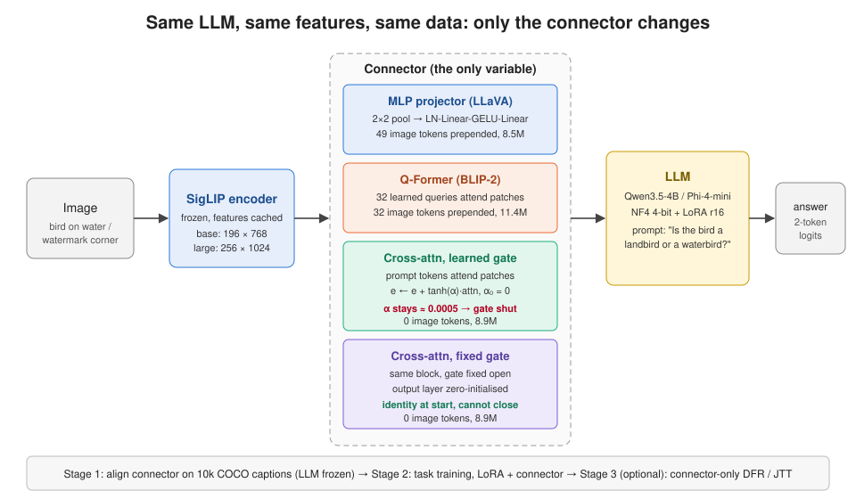

## Contents

- [Key findings](#key-findings)
- [Study design](#study-design): [Research question and hypotheses](#research-question-and-hypotheses) · [Tasks and datasets](#tasks-and-datasets) · [Connectors](#connectors) · [Training protocol](#training-protocol) · [Metrics](#metrics) · [Statistics](#statistics)
- [Results](#results): [1. Connector comparison, Qwen3.5-4B, SigLIP-base](#1-connector-comparison-qwen35-4b-siglip-base) · [2. Gate hypotheses](#2-gate-hypotheses-paired-by-seed) · [3. Second LLM](#3-second-llm-phi-4-mini-5-seeds) · [4. Vision encoder scale](#4-vision-encoder-scale-siglip-base-vs-siglip-large-waterbirds) · [5. Fixes](#5-fixes-connector-dfr-balanced-sampling-linear-dfr) · [6. CelebA](#6-celeba-blond_hair-vs-male-official-partitions-train-subsampled-to-8k) · [7. Ablations](#7-ablations-waterbirds-mlp-unless-noted) · [8. Reference points](#8-reference-points) · [9. Seed ensembles](#9-seed-ensembles-average-the-3-seeds-answer-probabilities) · [10. Linear probes on frozen SigLIP-base features, by pooling](#10-linear-probes-on-frozen-siglip-base-features-by-pooling-3-seeds) · [11. Attention on the watermark](#11-attention-on-the-watermark-watermark-task-3-seeds) · [12. Failure analysis](#12-failure-analysis-hardest-group-per-connector-3-seeds) · [13. Compute cost](#13-compute-cost-one-t4-batch-16-qwen35-4b-nf4) · [14. Gates in released Flamingo-style models](#14-gates-in-released-flamingo-style-models-idefics) · [15. More plots of the 3-seed connector comparison](#15-more-plots-of-the-3-seed-connector-comparison) · [16. Robustness checks for reviewers](#16-robustness-checks-for-reviewers)
- [Observations](#observations)
- [FAQ](#faq)
- [Related work and where this study stands](#related-work-and-where-this-study-stands)
- [Paper-writing kit (Q1 structure)](#paper-writing-kit-q1-structure)
- [Reproduce](#reproduce)
- [Limitations](#limitations)
- [Appendix: earlier experiment, VLM-SHIELD (Waterbirds, 1 seed)](#appendix-earlier-experiment-vlm-shield-waterbirds-1-seed)
- [Citation](#citation)

## Key findings

1. **A learnable injection gate induces shortcut reliance.** The Flamingo-type `tanh(α)` gate starts at 0 and
   never opens during alignment (it peaks below 0.01 and ends at |tanh α| ≈ 0.0005). Fixing the gate open
   raises worst-group accuracy by **+10.6 points on Waterbirds** (15 seeds, p = 4e-4) and **+23.8 on Watermark**
   (13 seeds, p = 3e-4), and removes the collapsed seeds (2/15 and 8/13 → 0). Tests H1 and H2 are
   both confirmed on Qwen3.5-4B, and H1 holds on the confirmation seeds alone (seeds 3+, p ≤ 0.0012). The gain holds with label-free checkpoint selection (+17.7 and +24.1), with
   unpaired Welch and Mann–Whitney tests (all p ≤ 0.002), and the fixed gate also raises average accuracy
   (84.1 → 88.0 and 76.9 → 85.8), so it is not a worst-group/average trade-off ([16](#16-robustness-checks-for-reviewers)).
2. **It replicates on a second LLM.** Phi-4-mini, 5 seeds: fixed > learned on both tasks (Waterbirds +9.7,
   p = 0.005; Watermark +31.6, p = 0.044, which misses the one-sided α = 0.025).
3. **Once the gate is fixed, no connector-type difference is detected.** MLP, Q-Former and fixed-gate
   cross-attention show no significant difference (MLP vs Q-Former, 5 seeds: p = 0.23 and 0.40), but
   equivalence is not established (TOST, ±3 points), and on CelebA MLP leads the fixed gate by 5 points (n.s.). Matching image-token counts
   (MLP with 36 instead of 49 tokens) changes nothing (74.7 vs 74.9).
4. **A stronger encoder masks the problem, so a shut gate is a risk factor, not a sufficient cause.** With
   SigLIP-large features the learned gate again ends alignment at 0.0006, yet its Waterbirds WGA no longer
   collapses (79.3 vs 80.1 fixed, 2 seeds). A small gate can be offset by larger output weights, so the study
   now logs the injected signal itself, `‖tanh(α)·out_proj(attn)‖ / ‖e‖` (round 4). All four connectors gain
   6–16 points from the bigger encoder.
5. **A cheap fix: retrain only the connector on a small balanced set (connector-DFR).** On Watermark it lifts the
   fixed-gate connector from 72.5 to **89.6 ± 0.5** WGA (5 seeds) and beats MLP + DFR (81.2) and a linear DFR
   probe on the same features (85.1). On Waterbirds it gives no gain (73.9 → 74.1).
6. **Off-the-shelf VLMs are no better.** Qwen3.5-4B with its own vision tower, zero-shot and calibrated on
   validation, reaches only **35.5%** WGA on Waterbirds. In released IDEFICS-80B checkpoints, **9 of 20** gated
   cross-attention layers have |tanh α| < 0.05, so near-shut gates also occur at scale.

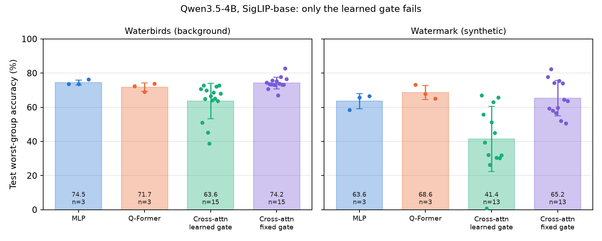

## Study design

### Research question and hypotheses

Holding the LLM, features, data and budget fixed, does the vision-language connector determine shortcut reliance?
Formulated after a 3-seed pilot and tested with one-sided α = 0.025. They were not pre-registered on a public
registry; to avoid forming and testing a hypothesis on the same data, H1 is also tested on the seeds run after the
pilot only (seeds 3+), where it holds on its own ([16](#16-robustness-checks-for-reviewers)):

- **H1:** a fixed injection gate gives higher worst-group accuracy than a learnable gate (paired by seed).
- **H2:** the learnable gate is less stable across seeds.
- **Secondary questions:**
  - Does connector type matter once the gate is fixed?
  - Does the effect replicate with Phi-4-mini?
  - Does it survive SigLIP-large?
  - Can a connector-only fix close the gap?

### Tasks and datasets

| Task | Shortcut | Label | Train correlation | Test (balanced groups) |
| :--- | :--- | :--- | :---: | :---: |
| **Waterbirds** (Sagawa et al., 2020) | image background (land / water) | landbird vs waterbird | 95% | official split, n = 5,794 |
| **Watermark** (ours, COCO images) | corner text watermark | "is there a dog?" | 95% | n = 2,400, group-balanced val/test |
| **CelebA** (Liu et al., 2015) | gender | blond hair vs not | natural (blond ≈ female) | official split |

Groups are (label, shortcut attribute); **worst-group accuracy** is the minimum accuracy over the four groups,
the standard metric for spurious-correlation robustness. Splits are deterministic (`study/build_tasks.py`, seed 0).

### Connectors

| Connector | Design | Image tokens | Trainable params |
| :--- | :--- | :---: | :---: |
| MLP projector (LLaVA-1.5) | LayerNorm–Linear–GELU–Linear over 2×2-pooled patches | 49 | 8.5M |
| Q-Former (BLIP-2) | 32 learned queries, 8 heads, 1 block | 32 | 11.4M |
| Input-level cross-attention, learned gate (Flamingo-type tanh gate) | prompt tokens attend to patches; `e ← e + tanh(α)·out_proj(attn)`, α initialised at 0, `out_proj` default init | 0 | 8.9M |
| Cross-attention, fixed gate | same block, `tanh(α)` fixed at 1, `out_proj` zero-initialised (still starts as the identity) | 0 | 8.9M |
| Cross-attention, open gate (control) | same block, α learnable but initialised at 3 (tanh = 0.995), `out_proj` zero-initialised | 0 | 8.9M |

**How this differs from Flamingo.** Flamingo inserts a gated cross-attention block before every 4th (9B) or
7th (80B) frozen LM layer, trains for 500k steps, and reports that its zero-initialised gates "quickly grow"
(Alayrac et al., 2022, App. A.1.2). Here one block injects visual context into the input embeddings only, and
alignment is 300 steps. The gate mechanism (`tanh(α)`, α = 0) is the same; depth and training length are not.
Flamingo also reports that removing the gate costs 4.2 points and destabilises training; our fixed gate instead
keeps the identity at initialisation through a zero-initialised output layer, and showed no instability.

The cross-attention variants have identical parameters and FLOPs. Learned and fixed gates differ in **two**
ways: whether `α` trains, and whether the identity at initialisation comes from the gate (α = 0) or from the
output layer (`out_proj` = 0). The open-gate control (`bottleneck_open`) shares the fixed gate's initialisation
but keeps `α` trainable, so it separates the two (round 3, running).

### Training protocol

| Item | Setting |
| :--- | :--- |
| LLM | Qwen/Qwen3.5-4B, NF4 4-bit (double quantisation), fp16 compute; native vision tower removed |
| Vision features | google/siglip-base-patch16-224, frozen, last layer, 196 patches x 768, cached once |
| Connectors | MLP (LayerNorm-Linear-GELU-Linear, 2x2 patch pooling, 49 tokens, 8.5M); Q-Former (32 queries, 8 heads, 1 block, 11.4M); cross-attention (attn dim 1024, 8 heads, 8.9M) with a learned zero-initialised tanh gate or a fixed gate with zero-initialised output |
| Stage 1 (alignment) | 10k COCO caption pairs (no task val/test images), 300 steps, batch 16, AdamW lr 1e-3, 3% warmup + cosine, LLM frozen |
| Stage 2 (task) | LoRA r 16, alpha 32, dropout 0.05 on attention, linear-attention and MLP projections; PagedAdamW8bit, lr 2e-4 (LoRA and connector), weight decay 0.01, batch 16, 4 epochs, 5% warmup + cosine, grad clip 1.0, early stop after 2 epochs without val WGA gain |
| Prompting | Chat template; answer = first token of the class word; 2 training question phrasings, 1 held out for test |
| Checkpoint selection | Best val worst-group accuracy (uses group labels); best val average accuracy reported as the label-free alternative |
| Stage 3 (connector-only) | From the selected stage-2 model, LLM and LoRA frozen. DFR-style: group-balanced half of val, other half selects. JTT-style: training set with the stage-2 model's errors repeated 20x. 1 epoch |
| Seeds | 15 (Waterbirds) and 13 (Watermark) per arm for the gate comparison, 5 for MLP vs Q-Former, Phi-4-mini and connector-DFR, 2–4 for follow-ups. A seed fixes data order, LoRA init and connector init, so the learned and fixed gate arms of one seed differ only in the gate. Watermark seeds 8 and 14 were never launched (session budget), not excluded; they are running now to equalise the arms at 15. Every finished run is reported |
| Hardware | Kaggle 2x NVIDIA T4 (16 GB); one job per GPU |

### Metrics

- **Worst-group accuracy (WGA, primary):** the lowest accuracy over the four (label, shortcut) groups on the
  test set. It is the mean over three question phrasings, one held out from training.
- **Average accuracy**, **ID accuracy** (groups where the shortcut agrees with the label), **OOD accuracy**
  (groups where it disagrees) and the **ID − OOD gap**.
- **Seed variance** of WGA (H2), and the learned gate value `tanh(α)` logged during alignment.

### Statistics

- Point estimates are means over seeds of test worst-group accuracy, averaged over the three question phrasings.
- Pairwise comparisons ([`results_study/significance_wga.md`](results_study/significance_wga.md)): 95% intervals
  from 2,000 stratified bootstrap resamples of the test set, and a **hierarchical bootstrap** that also resamples
  seeds. Significance uses the hierarchical p-value with Holm-Bonferroni correction within each task.
- The gate hypotheses were declared before the seed-extension runs and tested with one-sided paired t-tests,
  Wilcoxon signed-rank tests and variance F-tests ([`study/hypotheses.py`](study/hypotheses.py)).
- Apart from the gate (and DFR on Watermark), connector differences stay inside training variance.
- Robustness of H1 to the test and to model selection (Welch, Mann–Whitney, label-free checkpoints):
  [`results_study/robustness_checks.md`](results_study/robustness_checks.md), from `study/robustness_checks.py`.
- Effect sizes: paired Cohen's d_z; power analysis, assumption checks (Shapiro–Wilk, Brown–Forsythe) and the
  ±3-point equivalence test (TOST) are in [`paper/METHODOLOGY.md`](paper/METHODOLOGY.md).

## Results

All numbers: test **worst-group accuracy (WGA, %)**, mean ± s.d. over seeds, checkpoint chosen by validation WGA,
averaged over three question phrasings (one held out from training).

### 1. Connector comparison, Qwen3.5-4B, SigLIP-base

| Task | MLP projector | Q-Former | Cross-attn, learned gate | Cross-attn, fixed gate |
| :--- | :---: | :---: | :---: | :---: |
| Waterbirds | 74.5 ± 1.5 (5 seeds: 74.4) | 71.7 ± 2.5 (5 seeds: 72.8) | 63.6 ± 10.4 (15) | **74.2 ± 3.4** (15) |
| Watermark | 63.6 ± 4.4 (5 seeds: 66.2) | 68.6 ± 4.1 (5 seeds: 69.2) | 41.4 ± 19.0 (13) | **65.2 ± 10.4** (13) |

### 2. Gate hypotheses (paired by seed)

| LLM | Task | Seeds | Learned gate | Fixed gate | Gain (95% CI) | H1 paired t | H2 variance F | Collapsed (< 50) learned / fixed |
| :--- | :--- | :---: | :---: | :---: | :---: | :---: | :---: | :---: |
| Qwen3.5-4B | Waterbirds | 15 | 63.6 ± 10.4 | 74.2 ± 3.4 | +10.6 [+5.3, +16.0] | **4e-4** | **9e-5** | 2 / 0 |
| Qwen3.5-4B | Watermark | 13 | 41.4 ± 19.0 | 65.2 ± 10.4 | +23.8 [+12.5, +35.1] | **3e-4** | **0.02** | 8 / 0 |
| Phi-4-mini | Waterbirds | 5 | 60.4 ± 5.7 | 70.1 ± 3.6 | +9.7 [+3.8, +15.7] | **0.005** | 0.20 | 0 / 0 |
| Phi-4-mini | Watermark | 5 | 28.5 ± 21.3 | 60.1 ± 15.1 | +31.6 [−7.4, +70.6] | 0.044 | 0.26 | 4 / 2 |

H1: fixed > learned (one-sided, α = 0.025). H2: learned gate varies more across seeds. Bold = significant.
Tables: [`results_study/hypotheses.md`](results_study/hypotheses.md), [`results_study/phi/hypotheses.md`](results_study/phi/hypotheses.md).

Each line is one seed, learned gate → fixed gate (left: Qwen3.5-4B, right: Phi-4-mini):

<p>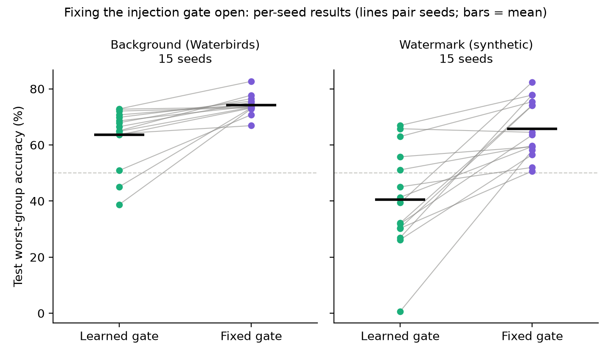 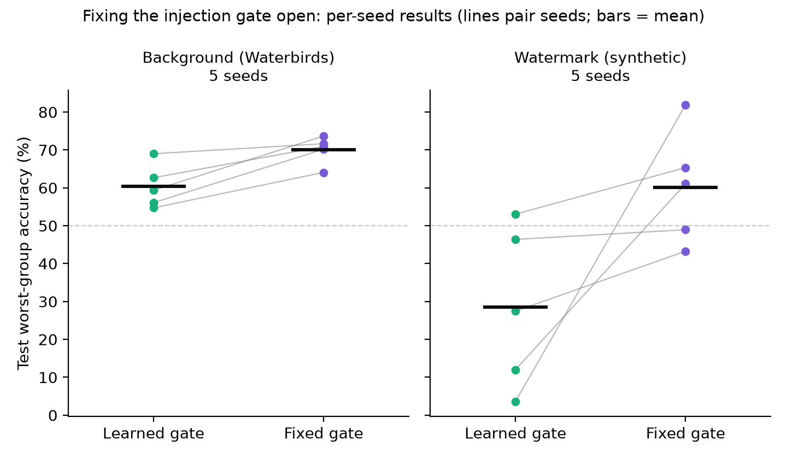</p>

### 3. Second LLM: Phi-4-mini, 5 seeds

| Task | MLP | Q-Former | Learned gate | Fixed gate |
| :--- | :---: | :---: | :---: | :---: |
| Waterbirds | **76.6 ± 3.6** | 71.9 ± 3.1 | 60.4 ± 5.7 | 70.1 ± 3.6 |
| Watermark | 62.2 ± 10.0 | **66.1 ± 10.7** | 28.5 ± 21.3 | 60.1 ± 15.1 |

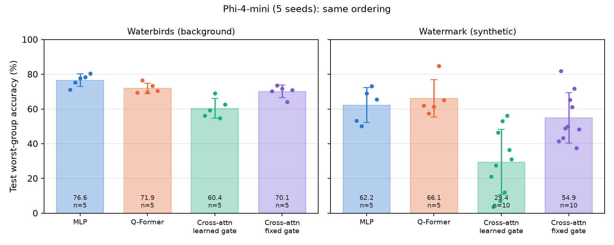

### 4. Vision encoder scale: SigLIP-base vs SigLIP-large (Waterbirds)

| Encoder | MLP | Q-Former | Learned gate | Fixed gate |
| :--- | :---: | :---: | :---: | :---: |
| SigLIP-base (196 × 768) | 74.5 | 71.7 | 63.6 | 74.2 |
| SigLIP-large (256 × 1024), 2 seeds | **82.9 ± 3.4** | 81.7 ± 0.4 | 79.3 ± 1.9 | 80.1 ± 3.1 |

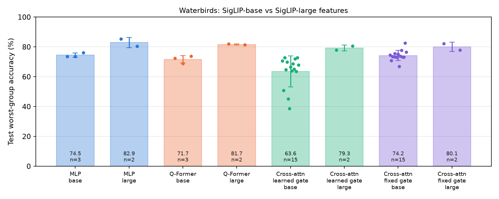

### 5. Fixes: connector-DFR, balanced sampling, linear DFR

| Method | Uses group labels | Waterbirds | Watermark |
| :--- | :--- | :---: | :---: |
| MLP (ERM) | selection only | 74.9 ± 1.4 | 64.9 ± 8.9 |
| MLP + connector-DFR | small balanced val half | 75.0 ± 3.6 | 81.2 ± 2.2 |
| Fixed gate (ERM) | selection only | 73.9 ± 2.5 | 72.5 ± 9.5 |
| **Fixed gate + connector-DFR** | small balanced val half | 74.1 ± 5.6 | **89.6 ± 0.5** |
| MLP + group-balanced sampling, 3 seeds | yes (training) | – | 89.1 ± 0.9 |
| Fixed gate + group-balanced sampling, 3 seeds | yes (training) | – | 87.1 ± 3.5 |
| Linear DFR on frozen SigLIP features (no LLM), 3 seeds | small balanced val half | **84.2 ± 1.5** | 85.1 ± 1.3 |
| Connector-JTT (1 seed) | selection only | 68.4 / 80.2 (fixed / MLP) | 49.9 / 58.6 |

Rows 1–4: 5 seeds each. Fixed gate + DFR beats MLP + DFR on Watermark by +8.4 [+6.0, +9.8] (p < 0.001, Holm-corrected).

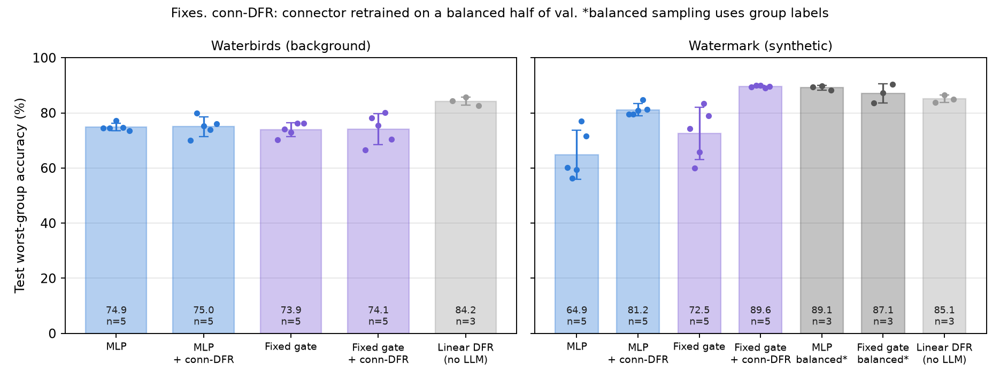

### 6. CelebA (Blond_Hair vs Male; official partitions, train subsampled to 8k)

| Connector | Seeds | WGA | Avg acc |
| :--- | :---: | :---: | :---: |
| MLP | 4 | **54.3 ± 13.7** | 94.1 ± 1.4 |
| Cross-attn, learned gate | 4 | 36.3 ± 18.7 | 87.4 ± 9.8 |
| Cross-attn, fixed gate | 2 | 49.3 ± 4.5 | 94.8 ± 0.3 |

Same direction as the other tasks (learned gate worst and least stable); not significant with these seeds.
Training uses a stratified 8,000-image subsample of the official train split (validation 5,000, full test),
so these numbers are **not comparable** to published full-data CelebA results.

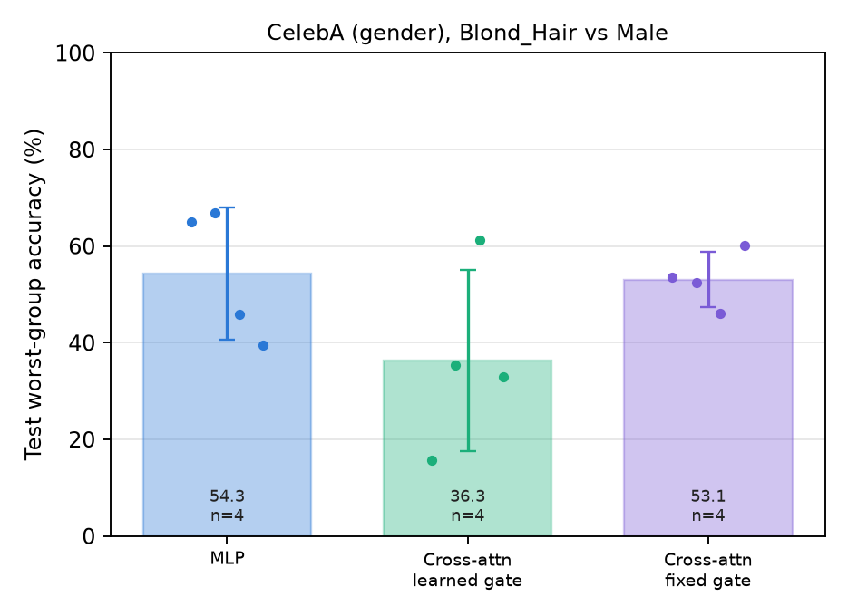

### 7. Ablations (Waterbirds, MLP unless noted)

| Variant | Seeds | WGA |
| :--- | :---: | :---: |
| Default (49 image tokens, 4 epochs) | 5 | 74.9 ± 1.4 |
| 36 image tokens | 2 | 74.7 ± 1.1 |
| + latent-target-decoding caption loss (LTD) | 3 | 75.9 ± 3.3 |
| 8 epochs | 1 | 79.1 |
| Fixed gate, 8 epochs (unresolved: may also degrade with long training; seeds 1–4 running) | 1 | 44.5 |
| Alignment repeated per seed: MLP / fixed gate | 3 | 76.1 ± 2.1 / 74.2 ± 0.8 |
| Fixed gate + LTD caption loss | 3 | 72.3 ± 3.7 |
| Group-balanced sampling: MLP / fixed gate (uses group labels) | 2 / 1 | 83.9 ± 1.9 / 87.3 |
| Attention-entropy regulariser: fixed gate / Q-Former | 1 | 72.1 / 69.8 |
| Frozen LLM (no LoRA): learned gate / MLP / Q-Former | 3 | **24.2 ± 2.8** / 73.4 ± 1.1 / 74.6 ± 0.9 |

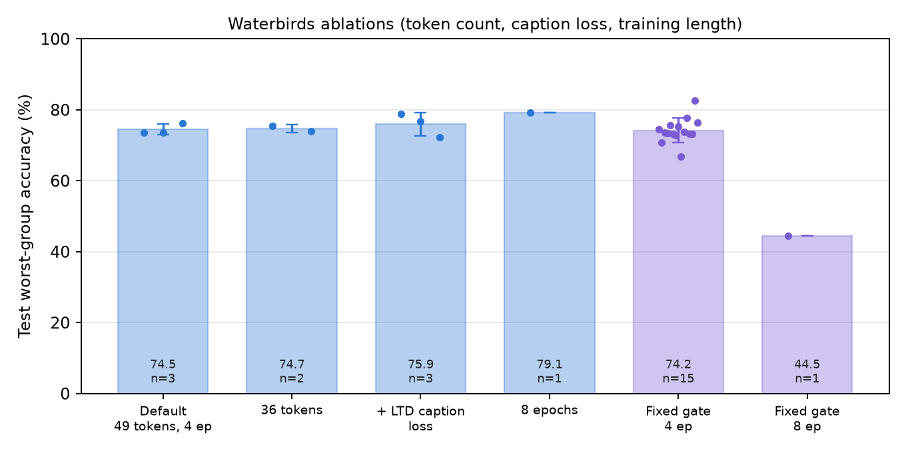

### 8. Reference points

| Model | Waterbirds WGA |
| :--- | :---: |
| Qwen3.5-4B native vision tower, zero-shot | 0.0 (always one class) |
| same, answer threshold calibrated on validation | 35.5 (avg 50.8) |
| Linear probe on SigLIP-base, ERM | 62.0 |
| Best connector in this study (MLP, SigLIP-large) | 82.9 |
| Linear DFR on SigLIP-base | 84.2 |

### 9. Seed ensembles (average the 3 seeds' answer probabilities)

| Task | MLP | Q-Former | Learned gate | Fixed gate |
| :--- | :---: | :---: | :---: | :---: |
| Waterbirds: single seed → ensemble | 74.5 → 74.1 | 71.7 → 74.0 | 62.1 → 69.1 | 73.5 → 74.2 |
| Watermark: single seed → ensemble | 63.6 → 64.3 | 68.6 → 68.9 | 50.3 → 52.3 | 69.6 → **76.7** |

Ensembling helps the unstable learned gate most but does not close its gap ([`seed_ensemble.csv`](results_study/seed_ensemble.csv)).

### 10. Linear probes on frozen SigLIP-base features, by pooling (3 seeds)

| Pooling | Waterbirds ERM / DFR / balanced-train | Watermark ERM / DFR / balanced-train |
| :--- | :---: | :---: |
| Mean over patches (768-d) | 62.0 / 84.2 / 84.3 | 46.5 / 85.1 / 84.7 |
| Mean + max (1,536-d) | 64.7 / 84.3 / 84.2 | 44.2 / 85.1 / 84.8 |
| 7×7 grid, the MLP connector's tokens (37,632-d) | 60.1 / 84.1 / 84.9 | 49.3 / 83.2 / 83.4 |

Pooling does not matter: DFR reaches about 84 whichever features it sees ([`linear_baselines*.md`](results_study/linear_baselines.md)).

### 11. Attention on the watermark (Watermark task, 3 seeds)

Share of the answer token's attention on the watermark corner (uniform = 8.2%):

| Connector | Watermark present | Absent |
| :--- | :---: | :---: |
| Cross-attn, learned gate | 16.7% | 6.1% |
| Cross-attn, fixed gate | 18.2% | 7.0% |
| Q-Former | 11.6% | 7.7% |

Both gate variants look at the watermark; only the learned gate relies on it
([`attention_watermark.csv`](results_study/attention_watermark.csv), threshold sweep in
[`attention_watermark_sensitivity.csv`](results_study/attention_watermark_sensitivity.csv)).

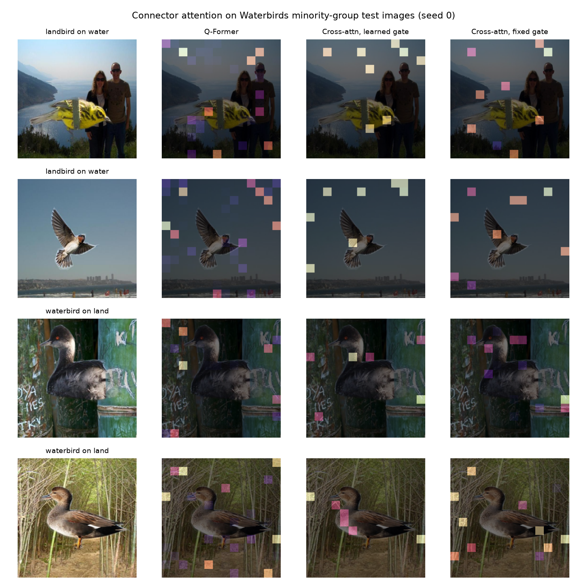

### 12. Failure analysis: hardest group per connector (3 seeds)

| Task, hardest group | MLP | Q-Former | Learned gate | Fixed gate |
| :--- | :---: | :---: | :---: | :---: |
| Waterbirds, waterbird on land (n = 642): error rate | 25.5% | 26.1% | 38.0% | 25.6% |
| … wrong in every seed / in any seed | 21% / 29% | 19% / 34% | 19% / **65%** | 20% / 32% |
| Watermark, no dog + watermark (n = 600): error rate | 37.4% | 32.1% | 49.5% | 24.5% |
| … wrong in every seed / in any seed | 25% / 51% | 15% / 49% | 20% / **81%** | 12% / 38% |

About 20% of the hardest images are wrong for every seed and connector (a shared core); the learned gate adds
seed-specific errors on top ([`failure_analysis.csv`](results_study/failure_analysis.csv)).

### 13. Compute cost (one T4, batch 16, Qwen3.5-4B NF4)

| Connector | Parameters | Image tokens | s / step | Peak memory | Train time (4 epochs) |
| :--- | :---: | :---: | :---: | :---: | :---: |
| MLP projector | 8.5M | 49 | 4.04 | 12.1 GB | 84 min |
| Q-Former | 11.4M | 32 | 2.48 | 10.1 GB | 55 min |
| Cross-attn (either gate) | 8.9M | 0 | **1.73** | **6.2 GB** | **37–40 min** |

The fixed-gate cross-attention connector matches MLP robustness at about half the time and memory
([`compute_table.csv`](results_study/compute_table.csv)).

### 14. Gates in released Flamingo-style models (IDEFICS)

Read straight from the Hugging Face checkpoints (only the gate tensors are downloaded):

| Model | Cross-attn gate, mean \|tanh α\| | Layers with \|tanh α\| < 0.05 |
| :--- | :---: | :---: |
| IDEFICS-9B / 9B-instruct | 0.114 / 0.115 | 1 of 8 |
| IDEFICS-80B / 80B-instruct | 0.068 / 0.067 | **9 of 20** |

Near-shut cross-attention gates also occur at 80B scale ([`pretrained_gates.md`](results_study/pretrained_gates.md)).

### 15. More plots of the 3-seed connector comparison

<p>
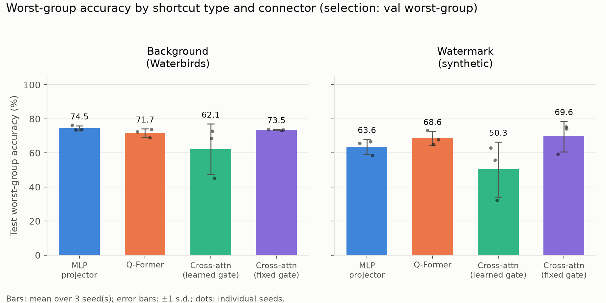
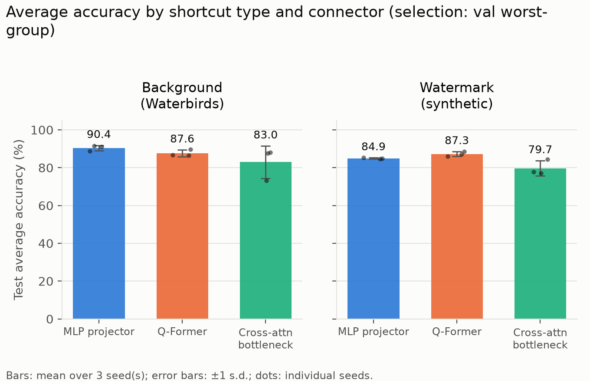
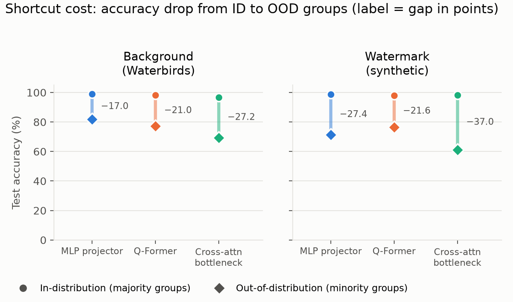
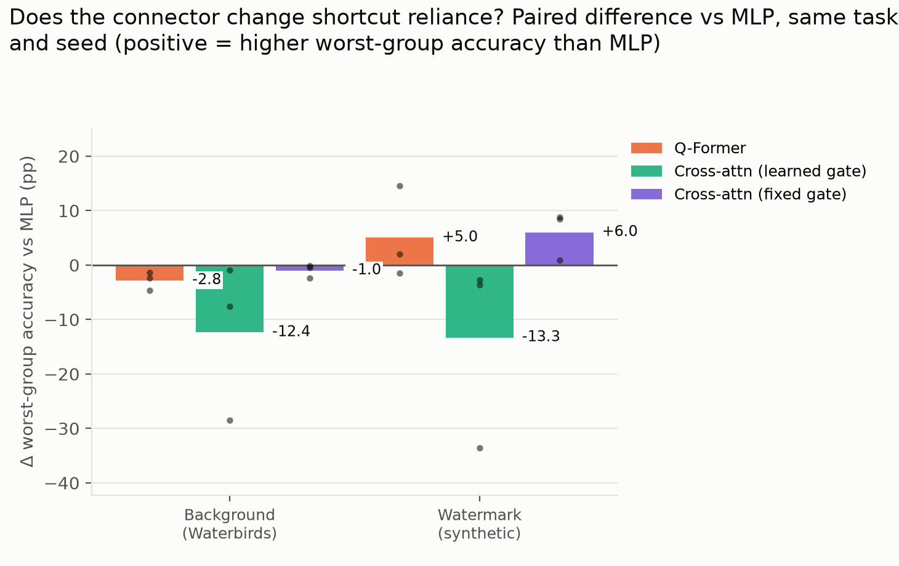
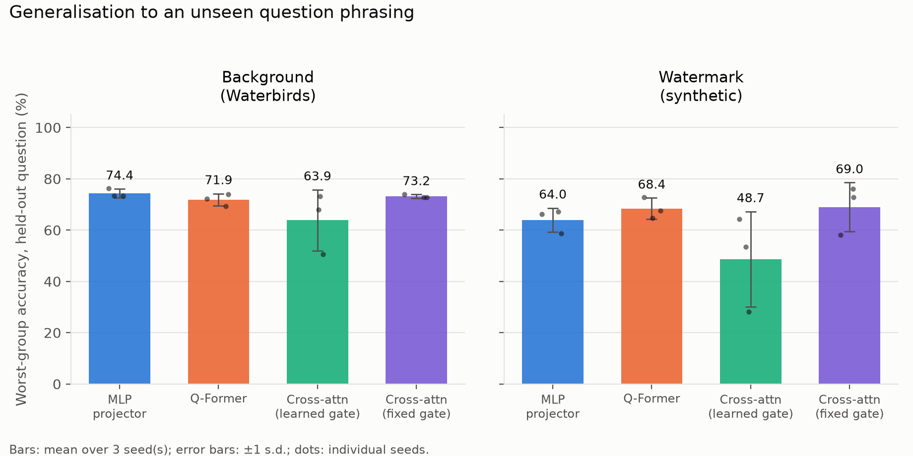
</p>

The same plots with checkpoints chosen without group labels (validation average accuracy):
[`wga_avg`](docs/figures/study/wga_avg.png), [`avg_avg`](docs/figures/study/avg_avg.png),
[`id_vs_ood_avg`](docs/figures/study/id_vs_ood_avg.png), [`delta_vs_mlp_avg`](docs/figures/study/delta_vs_mlp_avg.png),
[`heldout_avg`](docs/figures/study/heldout_avg.png). Per-experiment bar charts are in each
`results_study/<experiment>/wga_by_task.png`; every run is in [`all_runs.csv`](results_study/all_runs.csv).

### 16. Robustness checks for reviewers

Fixed vs learned gate, Qwen3.5-4B. Does the H1 gain depend on group-label model selection, on pairing seeds, on
trading average accuracy for worst-group accuracy, or on the pilot seeds the hypothesis was formed from? No to all four.

Generated by `study/robustness_checks.py`. Values are test means over seeds, in %. One-sided tests (fixed > learned) unless marked two-sided.

| Task | Checkpoint rule | Seeds | WGA learned | WGA fixed | Gain | Paired t p | Welch t p | Mann-Whitney p | Avg acc learned | Avg acc fixed | Avg p (two-sided) | ID acc learned | ID acc fixed |
| :--- | :--- | :---: | ---: | ---: | ---: | ---: | ---: | ---: | ---: | ---: | ---: | ---: | ---: |
| waterbirds | val WGA (group labels) | 15 | 63.6 | 74.2 | +10.6 | 0.0004 | 0.00076 | 1.2e-05 | 84.1 | 88.0 | 0.007 | 97.6 | 98.2 |
| waterbirds | val average (label-free) | 15 | 53.6 | 71.4 | +17.7 | 0.0018 | 0.0021 | 8.7e-05 | 88.0 | 90.0 | 0.0094 | 97.2 | 98.1 |
| watermark_p0.95 | val WGA (group labels) | 13 | 41.4 | 65.2 | +23.8 | 0.00031 | 0.00044 | 0.0012 | 76.9 | 85.8 | 0.003 | 97.7 | 98.1 |
| watermark_p0.95 | val average (label-free) | 13 | 41.0 | 65.1 | +24.1 | 0.00028 | 0.00036 | 0.00088 | 78.4 | 85.8 | 9.3e-05 | 97.8 | 98.2 |

#### Pilot (seeds 0-2) vs confirmation sample (seeds 3 and later)

H1 was formulated after a 3-seed pilot. Testing it only on the seeds run afterwards avoids using the same data to form and test the hypothesis.

| Task | Sample | Seeds | WGA learned | WGA fixed | Gain | Paired t | p (one-sided) | Wilcoxon p | d_z |
| :--- | :--- | :---: | ---: | ---: | ---: | ---: | ---: | ---: | ---: |
| waterbirds | pilot | 3 | 62.1 | 73.5 | +11.4 | 1.34 | 0.16 | 0.12 | 0.77 |
| waterbirds | confirmation | 12 | 63.9 | 74.4 | +10.5 | 4.06 | 0.00095 | 0.00024 | 1.17 |
| watermark_p0.95 | pilot | 3 | 50.3 | 69.6 | +19.3 | 1.66 | 0.12 | 0.12 | 0.96 |
| watermark_p0.95 | confirmation | 10 | 38.8 | 63.9 | +25.1 | 4.15 | 0.0012 | 0.002 | 1.31 |

Reading: the gain survives label-free model selection and tests that do not pair seeds, and the fixed gate raises average accuracy as well, so the worst-group gain is not bought with accuracy elsewhere.

Holm correction across the four H1 tests (2 LLMs × 2 tasks): Qwen Watermark p_adj = 0.0012, Qwen Waterbirds 0.0012,
Phi-4-mini Waterbirds 0.011 (all < 0.025); Phi-4-mini Watermark 0.044 fails (5 seeds; seeds 5–9 added, analysis pending).

| Check | Status |
| :--- | :--- |
| Gate trainable vs zero-init location (`bottleneck_open`, 2 tasks × 5 seeds) | running (round 3) |
| Learning rate 5e-5 / 1e-3 (MLP, both gates, 3 seeds) | running (round 3) |
| Longer alignment, 3,000 steps (both gates, 2 tasks, 3 seeds) | running (round 3) |
| Injected-signal strength, SigLIP-base and -large | running (round 4) |
| 8-epoch training, seeds 1–4 (MLP, both gates) | running (round 4) |
| Group DRO full-model baseline (MLP, both gates, 2 tasks, 2 seeds) | running (round 4) |
| Watermark seeds 8 and 14 (both gates → 15 per arm) | running (round 4) |
| Behavioural pathway test: visual contribution removed at inference (learned, fixed gate) | running (round 5) |
| Gate left out of gradient clipping; raw pre-clip gradients logged (learned gate, 3 seeds) | running (round 5) |
| No weight decay on the gate (learned gate, 2 seeds) | running (round 5) |
| Shortcut strength p = 0.9 / 0.99 on Watermark (MLP, both gates, 3 seeds) | queued (round 5) |

## Observations

- **The gate, not the connector family, decides robustness.** Every failure we see traces to the learnable
  gate: it is near zero after alignment, its gradient changes sign every step, and with it shut the LLM
  falls back on whatever cue is easiest. A fixed gate with a zero-initialised output layer starts as the
  identity, so the optimiser cannot close it.
- **The failure is a seed lottery.** The learned gate is not uniformly worse: some seeds match the fixed gate,
  others collapse below 50%. Variance, not only the mean, is the effect (H2).
- **Stronger features mask it.** With SigLIP-large the gate still shuts, but the learned-gate model no longer
  collapses on Waterbirds. Two seeds only; the safe reading is "a better encoder hides the problem", not
  "fixes it".
- **The information is in the features; the VLM does not use it.** A linear DFR probe on the same frozen
  features beats every ERM-trained VLM by about 10 points. Retraining only the connector on a few hundred
  balanced examples closes that gap on Watermark but not on Waterbirds.
- **Attention on the shortcut does not mean reliance on it.** Both cross-attention variants attend to the
  watermark corner about 2.5x more when it is present, yet only the learned-gate model fails.
- **Waterbirds on land is the hardest group** for every connector.
- **Longer training is not a free win.** At 8 epochs the MLP gains and the fixed gate collapses on one seed;
  with one seed each this is a warning, not a result.

## FAQ

**Why does a learnable gate hurt?** It is initialised at 0 so the pretrained LLM is untouched at the start. During
alignment its gradient keeps flipping sign and it stays near zero, so almost no image information reaches the LLM;
the LoRA-tuned LLM then learns whichever cue is easiest, which is the shortcut.

**Why is the fixed gate not just "more parameters"?** Both variants have identical parameters and FLOPs; only
whether `α` is trainable differs. The fixed variant zero-initialises the output layer instead, so it also starts as
the identity.

**Does this apply to Flamingo / IDEFICS / Llama-3.2-Vision?** They all use tanh-gated cross-attention. We only
train 4B-scale models, but released IDEFICS-80B checkpoints have 9 of 20 cross-attention gates below 0.05.

**What should practitioners do?** Use a fixed (or output-zero-initialised) injection instead of a learnable gate,
check worst-group accuracy over several seeds, and if a small group-balanced set exists, retrain only the
connector on it (connector-DFR).

**Is the MLP projector the safest choice?** With a fixed gate, MLP, Q-Former and cross-attention show no significant
difference (5 seeds; an equivalence test with a ±3-point margin is not passed, so "no significant difference detected", not
"equivalent"); cross-attention is about 2x cheaper in time and memory.

## Related work and where this study stands

Full literature review with what each source did, what we learned and what we used: [`docs/LITERATURE.md`](docs/LITERATURE.md).

Literature check (October 2026): Google Scholar, OpenAlex (covers Springer, Elsevier, IEEE, ACM, ACL,
AAAI and arXiv), forward citations of the closest papers, and full reads of the five nearest. No
paper we found compares connector designs for shortcut reliance in LLM-based VLMs. Numbers below are
as reported by each paper, on their own setups, so they are context rather than a like-for-like ranking.

### Shortcuts in vision-language models

| Work | What they did | Models | Data | Reported result |
| :--- | :--- | :--- | :--- | :--- |
| Bleeker et al., 2024 (arXiv 2402.17510) | Inject synthetic per-pair shortcuts (MNIST digit in image + number in caption) into contrastive training; mitigate with latent target decoding (LTD) or implicit feature modification (IFM) | CLIP (fine-tuned), VSE++ | Flickr30k, MS-COCO retrieval | Flickr30k recall sum: VSE++ 409.0 without shortcuts, 3.4 with them, 274.6 with LTD; CLIP 543.5 without, 436 with, 464 with LTD, 495 with IFM |
| SpurLens (arXiv 2503.08884) | Automatic detection of spurious cues in multimodal LLMs | LLaVA and other MLLMs, zero-shot | Waterbirds and others | LLaVA per-group accuracy: waterbird on land 13.2%, waterbird on water 59.3%, landbird groups 77.4% and 99.8% |
| SpuriVerse (arXiv 2506.18322) | Benchmark of 124 spurious correlations mined from real VQA data | Large VLMs | SpuriVerse | Fine-tuning on spurious cases trades off accuracy on ordinary samples |
| PURGE (arXiv 2608.29996) | Unlearning to remove object-background correlations | LLaVA-1.6-7B, Qwen3-VL-8B, Qwen3.5-9B | Object-background benchmarks | Connector treated as fixed |
| MD3 / MAD (ICLR 2026 submission, OpenReview NTbAH4UD6K) | GPT-4o "critic agents" rewrite biased answers into ~50k debiased reasoning chains, then fine-tune MLLMs | LLaVA-v1.5-7B, LLaVA-Llama-3-8B, Llama-3.2-11B-Vision | VQA-CP, VQA-CE, GQA-OOD; Waterbirds on ResNet-50 | VQA-CP (LLaVA-v1.5-7B): 63.98 → 68.83. Waterbirds WGA (ResNet-50): ERM 63.7, GroupDRO 89.9, DFR 90.2, MOO 91.8, MAD 93.6 |
| Scaling VLMs Is Not Enough (arXiv 2607.28211) | 194 contrastive models, 16 families; which design factors predict robustness | OpenCLIP models | ImageNet, CelebA, UrbanCars | Data size and curation matter more than scale; connector type not studied |

### Connector design

| Work | What they did | Reported result | Shortcuts measured? |
| :--- | :--- | :--- | :--- |
| Modality Integration Rate (arXiv 2410.07167) | Alignment quality of LLaVA-1.5 with an MLP vs a Q-Former connector | MLP clearly outperforms Q-Former after instruction tuning | No |
| Rethinking Projector Training (arXiv 2610.18598) | What projector alignment learns; training-free PORTAL projector | Alignment is coarse; 10-20% of the 558k pairs recover most gains; PORTAL matches a trained MLP with ~135x fewer alignment FLOPs | No |
| The Gate Always Closes (Farazi et al., arXiv 2607.23335) | Learnable gates for injecting signals into frozen VLMs, across five designs | Every gated pathway ends up behaviourally closed; recommends fixed injection | No |
| Honeybee, TokenPacker (IJCV 2025), Cambrian-1 | Locality-aware and efficient projectors | Benchmark accuracy and token efficiency | No |

### Group-robustness baselines (Waterbirds worst-group accuracy, ResNet-50)

| Method | Uses group labels in training | WGA | Source |
| :--- | :--- | :---: | :--- |
| ERM | No | 63.7 | as reported in MD3 |
| JTT | Only for model selection | 86.7 | Liu et al., 2021 |
| GroupDRO | Yes | 89.9 | as reported in MD3 |
| DFR | Small group-balanced set | 90.2 | as reported in MD3 |
| **This repo, MLP projector (Qwen3.5-4B, connector study)** | Only for model selection | **74.5 ± 1.5** | 3 seeds |
| **This repo, MLP + group-balanced sampling (PR #1 run)** | Yes | **82.8** | 1 seed |
| **This repo, DFR on frozen SigLIP-base features** | Small group-balanced set | **84.2 ± 1.5** | 3 seeds |

### Where this study stands out

- **Question nobody isolated:** with the LLM, vision features, data and budget held fixed, does the
  connector (MLP, Q-Former, cross-attention) change how much a generative VLM relies on a shortcut?
  Prior shortcut work studies contrastive models (Bleeker; scaling study) or whole MLLMs (SpurLens,
  SpuriVerse, PURGE, MD3); prior connector work measures benchmark accuracy, not robustness.
- **Group-level evaluation of generative VLMs:** worst-group accuracy, ID-to-OOD gap, a held-out question
  phrasing, and two checkpoint-selection rules, over seeds.
- **A mechanism with a fix:** a learnable injection gate stays shut (0.0005), and that alone turns a
  cross-attention connector from on-par to the most shortcut-reliant and unstable; fixing the gate open
  restores it (+10.6 and +23.8 WGA points over 15 and 13 seeds). This links the gate-suppression effect of Farazi et al. to
  shortcut reliance, which they did not measure.
- **Reference points on the same features:** a linear ERM probe and DFR bracket every VLM, showing how
  much of the gap is the model's, not the features'.
- **Once that pitfall is avoided, connector type is a near-null factor**, consistent with MD3's and the
  scaling study's view that data and training, not architecture, are the main lever.

## Paper-writing kit (Q1 structure)

Everything needed to write the journal paper from this repository:

| Part | File |
| :--- | :--- |
| Title options, abstract, keywords, highlights, target journals | [`paper/TITLE_ABSTRACT.md`](paper/TITLE_ABSTRACT.md) |
| Introduction (CARS five-paragraph funnel) | [`paper/INTRODUCTION.md`](paper/INTRODUCTION.md) |
| Literature review: background, themes, contradictions, gaps, bridge to hypotheses | [`docs/LITERATURE.md`](docs/LITERATURE.md) |
| Synthesis matrix of 88 papers (objective, finding, limitation, use) | [`paper/literature_matrix.csv`](paper/literature_matrix.csv) |
| 94 verified references (arXiv API / Crossref), 25 journal articles | [`paper/references.bib`](paper/references.bib) (built by [`paper/build_refs.py`](paper/build_refs.py)) |
| Methodology: design, data, variables, power analysis, tests, assumptions, validity, ethics | [`paper/METHODOLOGY.md`](paper/METHODOLOGY.md) |
| Results (per hypothesis, effect sizes) and discussion (mechanism, implications, limitations) | [`paper/RESULTS_DISCUSSION.md`](paper/RESULTS_DISCUSSION.md) |
| Claims and structure | [`paper/OUTLINE.md`](paper/OUTLINE.md) |
| What was changed for reviewers, why, and where (plain-language log) | [`docs/REVIEW_HARDENING.md`](docs/REVIEW_HARDENING.md) |
| Reviewer pre-submission checklist (30 likely concerns, status of each) | [`paper/SUBMISSION_CHECKLIST.md`](paper/SUBMISSION_CHECKLIST.md) |

## Reproduce

### Quick start

```bash
git clone https://github.com/Naveenvaidani/VLM-Debias.git && cd VLM-Debias
python -m venv .venv && source .venv/bin/activate
pip install -r requirements-study.txt          # pinned versions used on Kaggle

# rebuild every table and figure from the saved results (CPU, no downloads)
python study/hypotheses.py --runs_dir <merged runs>/qwen35-4b --out results_study
python study/final_figures.py --results results_study --out docs/figures/final

# train one connector end to end (one 16 GB GPU)
python study/build_tasks.py --coco_root <coco2017> --split train2017 --out data/tasks   # task splits
python study/cache_features.py --tasks_dir data/tasks --vision_model google/siglip-base-patch16-224
python study/align.py --llm Qwen/Qwen3.5-4B --connector bottleneck_fixed --out runs/align/bottleneck_fixed --mlp_pool 2
python study/train_task.py --llm Qwen/Qwen3.5-4B --connector bottleneck_fixed --task_dir data/tasks/waterbirds \
    --align_ckpt runs/align/bottleneck_fixed/connector.pt --run_dir runs/waterbirds/bottleneck_fixed/s0 --seed 0 --mlp_pool 2
```

Full Kaggle pipeline (2× T4, resumable): [`study/kaggle_kernels/`](study/kaggle_kernels/) and `study/kaggle_study.py`.

### Reproducibility

- Every Kaggle run writes `environment.txt` (exact `pip freeze`, GPU driver, git commit) next to its results.
- Data splits are deterministic (`study/build_tasks.py`, seed 0); Waterbirds uses the official splits.
- `study/kaggle_kernels/` holds the exact scripts for every run; runs resume from exported results.
- Unit tests: `python -m pytest tests` (18).

### Repository layout

```
src/data/waterbirds.py          dataset, cached-feature loader, group metrics
src/models/debiased_vlm.py      LocalFeatureBottleneck, MLPPrefixProjector, DebiasedVLM (QLoRA Qwen3.5)
src/models/*_scratch.py         small pure-PyTorch SigLIP/Qwen re-implementations (tests / teaching)
src/models/lora.py              minimal LoRA layer used by the scratch models
src/training/loss.py            task loss + attention entropy / shortcut-suppression regularisers
src/training/engine.py          train / eval loops, group-balanced sampler
scripts/                        data preparation, feature caching, model download, run_all.sh
train.py / evaluate.py / app.py training, evaluation + figures, demo
metrics/                        exported results and figures
src/study/, study/              connector study: connectors, generic VLM wrapper, tasks, training, plots
results_study/                  connector-study results per experiment (tables, per-seed CSVs, significance)
docs/figures/                  architecture diagram, summary figures (final/), 3-seed plots (study/)
docs/LITERATURE.md             literature review
paper/                         paper kit: outline, introduction, methodology, results, references
```

### Where each result lives

| Experiment | Results | Kaggle script |
| :--- | :--- | :--- |
| Four connectors, Qwen3.5-4B (3–5 seeds) | [`results_study/summary.md`](results_study/summary.md), [`five_seed_mlp_qformer.md`](results_study/five_seed_mlp_qformer.md) | `study/kaggle_kernels/study*` |
| Gate hypotheses H1/H2 (13–15 seeds) | [`results_study/hypotheses.md`](results_study/hypotheses.md), [`h1/`](results_study/h1) | `h1a`, `h1b`, `seeds34` |
| Phi-4-mini (5 seeds) | [`results_study/phi/`](results_study/phi) | `phi-*` |
| SigLIP-large | [`results_study/siglip_large/`](results_study/siglip_large) | `siglip-large` |
| Connector-DFR / JTT | [`results_study/stage3/`](results_study/stage3) | `stage3*` |
| Group-balanced sampling | [`results_study/balanced/`](results_study/balanced) | `extras` |
| CelebA | [`results_study/celeba/`](results_study/celeba) | `celeba*` |
| Ablations (36 tokens, LTD, 8 epochs, frozen LLM) | [`mlp36/`](results_study/mlp36), [`ltd/`](results_study/ltd), [`long8/`](results_study/long8), [`frozen/`](results_study/frozen) | `extras`, `ltd-mlp`, `study-sweep` |
| Linear probes and DFR | [`results_study/linear_baselines.md`](results_study/linear_baselines.md) | `study/linear_baselines.py` |
| Native zero-shot VLM | [`results_study/native_waterbirds.json`](results_study/native_waterbirds.json) | `study/native_vlm.py` |
| Released IDEFICS gate values | [`results_study/pretrained_gates.md`](results_study/pretrained_gates.md) | `study/pretrained_gates.py` |
| Figures | [`docs/figures/final/`](docs/figures/final) (PNG + PDF) | `study/final_figures.py` |

## Limitations

- 13–15 seeds for the gate comparison, 3–5 for most other cells; SigLIP-large and the 36-token MLP have 2
  seeds, CelebA's fixed gate 2, the 8-epoch runs 1 (all being extended: rounds 3–4). The learning rate
  (2e-4) was not tuned per connector; a sweep (5e-5, 1e-3) is running.
- Learned and fixed gates differ in trainability *and* in where the zero initialisation sits (gate vs output
  layer); the open-gate control separates them.
- A near-zero gate does not by itself imply a near-zero injection, because `out_proj` can grow; the SigLIP-large
  result shows the gate alone does not decide reliance. The injection ratio is logged from round 4 on.
- The fixed gate fell to 44.5 WGA in the single 8-epoch run; whether long training also hurts it is open.
- CelebA trains on an 8k subsample, so its numbers are not comparable to full-data benchmarks.
- Group DRO is compared only as a full-model baseline in round 4 (running); JTT only at the connector.
- Injection is input-level (one gated block on the embeddings), not one per LM layer as in Flamingo, and
  alignment is 300 steps where Flamingo trains 500k; Flamingo's gates do open over that schedule.
- H1/H2 were formulated after a 3-seed pilot and not pre-registered; the confirmation-only test is reported.
- The gate gradient logged up to round 4 is the post-clipping value; raw gradients are logged from round 5.
- One Watermark shortcut strength (0.95) until the round-5 dose–response finishes.
- Waterbirds and CelebA are licensed for non-commercial research; SigLIP's web pre-training may include
  CUB, Places or COCO images (shared by every arm).
- MLP vs Q-Former equivalence is not established (TOST, ±3 points, 5 seeds); the claim is "no significant difference detected".
- Two 4-bit LLMs of 4B parameters or fewer; results may differ for larger or full-precision models.
- The Watermark shortcut is partly textual (readable watermark), and Qwen3.5 was pretrained with its own
  vision merger, which our connectors replace.
- In most runs stage-1 alignment ran once per connector; repeating it per seed (3 seeds, `--align_per_seed`) gave similar results (MLP 76.1, fixed gate 74.2).
- LoRA also adapts the LLM, which can learn the shortcut whatever the connector; the frozen-LLM run
  (`--freeze_llm`, 3 seeds) separates the two.
- Alignment is short (300 steps on 10k captions; LLaVA uses 558k pairs), and the MLP uses 2x2-pooled
  patches (49 tokens) instead of all 196 for speed.
- Average accuracy is the plain test mean, not reweighted by training group sizes as in some papers.
- Checkpoints are selected with group labels (val WGA), as is standard; with the label-free rule (best val
  average accuracy) the gate effect is larger, not smaller (`results_study/robustness_checks.md`).
- The vision encoder is frozen; only LoRA adapters and the connector are trained.

## Appendix: earlier experiment, VLM-SHIELD (Waterbirds, 1 seed)

The repository started as **VLM-SHIELD**: the prompt tokens cross-attend to individual SigLIP patches and the
attended context enters the LLM through a zero-initialised tanh gate, so the answer token's attention map is
inspectable. The connector study grew out of it; its learned-gate connector is this design.

### VLM-SHIELD results (Waterbirds test set, n = 5,794)

| Model | Avg acc | Worst-group acc | Acc_ID | Acc_OOD | Δ_OOD | RSR |
| :--- | :---: | :---: | :---: | :---: | :---: | :---: |
| MLP projector (baseline) | 90.4% | 80.4% | 98.3% | 82.5% | 15.8 pp | 0.161 |
| VLM-SHIELD bottleneck | 89.2% | 77.3% | 97.1% | 81.3% | 15.8 pp | 0.163 |
| MLP projector + group-balanced sampling | **90.8%** | **82.8%** | 96.9% | **84.6%** | **12.3 pp** | **0.127** |
| VLM-SHIELD + group-balanced sampling | 89.4% | 80.9% | 96.5% | 82.3% | 14.2 pp | 0.147 |

Qwen3.5-4B (4-bit QLoRA) for every row; checkpoint selected by validation worst-group accuracy.
Per-group numbers are in [`metrics/research_paper_metrics.md`](metrics/research_paper_metrics.md),
and everything is in [`metrics/benchmark_results.json`](metrics/benchmark_results.json).

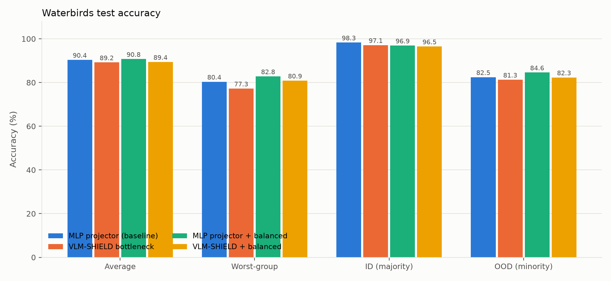

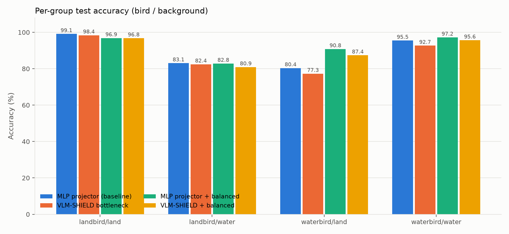

##### What the numbers say

- **The shortcut is real.** Every model is 12–16 points less accurate on birds shown on the
  "wrong" background, and `waterbird/land` or `landbird/water` is always the worst group.
- **The cross-attention bottleneck does not beat the MLP projector here.** It is 2–3 points lower
  on worst-group accuracy in both the ERM and balanced settings. With one seed per configuration
  that gap is within noise, so the honest reading is "no measurable benefit", not "worse".
- **Group-balanced sampling helps both architectures** (+2.5 pp worst-group for the MLP, +3.6 pp
  for the bottleneck) and gives the best model overall: 82.8% worst-group, RSR 0.127.
- **Training is unstable under ERM.** Validation worst-group accuracy swings by 30–40 points
  between epochs (below), so early stopping on worst-group accuracy matters more than the number
  of epochs. Balanced sampling makes the curves much smoother.

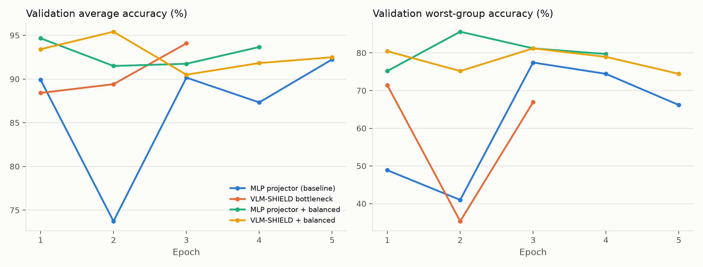

##### Where the bottleneck looks

The answer token's cross-attention over the 14×14 SigLIP patches, on test images of waterbirds
photographed on land backgrounds (the hardest group). Attention is sparse (normalised entropy
0.50 for the balanced model) and lands on both bird and background patches. The bottleneck makes
this inspectable, but it does not force the model onto the bird.

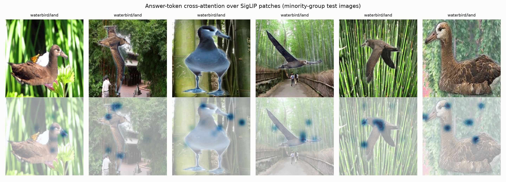

The same for the ERM model: [`metrics/attention_bottleneck.png`](metrics/attention_bottleneck.png).

### Setup

| Component | Choice |
| :--- | :--- |
| Vision encoder | `google/siglip-base-patch16-224`, frozen; 196 patch features (768-d) cached once |
| Language model | `Qwen/Qwen3.5-4B` text decoder, 4-bit NF4 (QLoRA), LoRA r=16 on all attention/MLP projections |
| VLM-SHIELD connector | `LocalFeatureBottleneck`: prompt tokens attend over the 196 patches; output added to the token embeddings through `tanh(gate)`, gate initialised at 0 |
| Baseline connector | LLaVA-style 2-layer MLP over 2×2-pooled patches → 49 prefix tokens |
| Task | Prompt *"Is the bird in this image a landbird or a waterbird?"*; prediction = LLM next-token logits restricted to the two answer tokens |
| Loss | Cross-entropy + 0.1 × normalised attention-entropy penalty `1 − H(A)/log 196` (bottleneck only) |
| Training | Paged 8-bit AdamW, cosine schedule, batch 16, gradient checkpointing, bf16; up to 8 epochs with early stopping on validation worst-group accuracy |
| Variants | ERM (natural sampling) and group-balanced sampling (each bird/background group equally likely) |
| Hardware | One RTX 3050 Laptop GPU (4 GB) |

The 248k-row token embedding matrix (tied with the LM head) is never put on the GPU: the prompt is
fixed, so its embeddings are computed once, and only the two answer-token rows of the LM head are
kept. This, plus 4-bit weights, is what lets a 4B model train in 4 GB.

### Metrics

Groups are (bird, background): `landbird/land`, `landbird/water`, `waterbird/land`, `waterbird/water`.

- **Average accuracy** over the test set.
- **Worst-group accuracy**: the lowest of the four group accuracies (the standard Waterbirds metric).
- **Acc_ID / Acc_OOD**: accuracy on majority groups (bird on its usual background) vs minority groups.
- **Δ_OOD = Acc_ID − Acc_OOD** and **RSR = Δ_OOD / Acc_ID** (relative shortcut reliance).

All numbers are computed by `evaluate.py` from model predictions on the held-out test split.

### Reproduce

```bash
python -m venv .venv && source .venv/bin/activate
pip install torch --index-url https://download.pytorch.org/whl/cu124
pip install -r requirements.txt

python scripts/prepare_waterbirds.py          # Waterbirds -> data/waterbirds/{images,metadata.csv}
python scripts/download_models.py             # SigLIP + Qwen3.5-4B into the HF cache
python scripts/cache_siglip_features.py       # frozen SigLIP features -> data/siglip_patch_features.npy

# One run
python train.py --mode bottleneck --balanced --gradient_checkpointing

# All four runs (MLP / bottleneck x ERM / balanced), 110 min budget each, then evaluation
PYTORCH_CUDA_ALLOC_CONF=expandable_segments:True scripts/run_all.sh Qwen/Qwen3.5-4B 110

python evaluate.py                            # metrics/*.csv|json|md + figures
python -m pytest tests                        # unit tests
python app.py --run bottleneck_balanced       # Gradio demo with attention heatmap
```

### Limitations

- One seed per configuration; differences of a few points are within run-to-run noise.
- Waterbirds has no shortcut-region masks in this setup, so the shortcut-suppression term of the
  loss is implemented and tested but not used in these runs.

## Citation

If you use this code or the findings, please cite the repository:

```bibtex
@misc{vlmdebias2026,
  title  = {Does the Vision-Language Connector Cause Shortcut Learning? A Controlled Study of Injection Gates in LLM-based VLMs},
  author = {{VLM-Debias contributors}},
  year   = {2026},
  howpublished = {\url{https://github.com/Naveenvaidani/VLM-Debias}}
}
```
