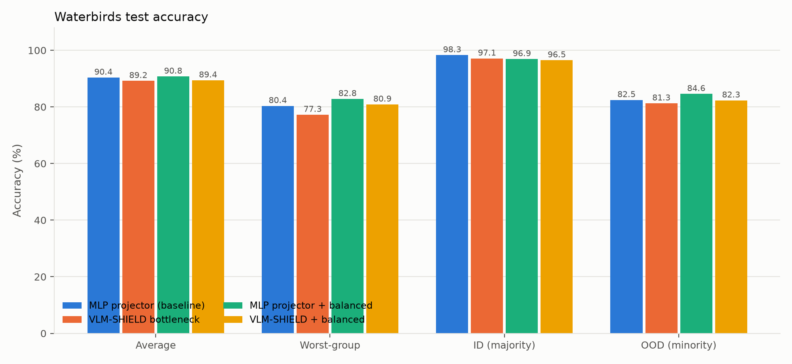
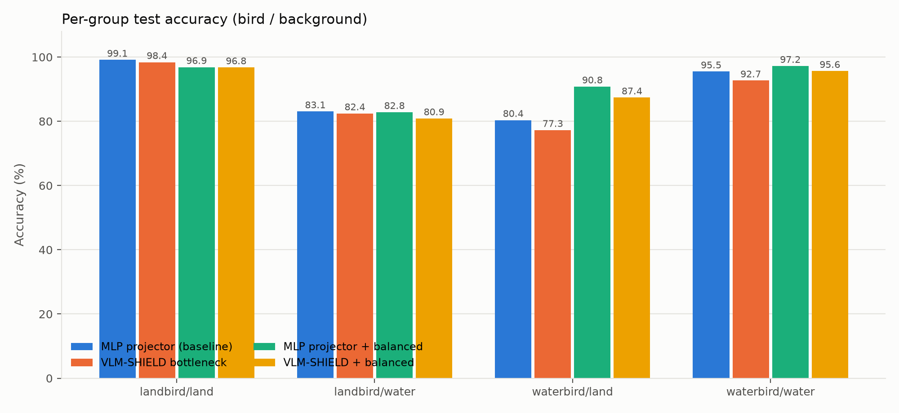
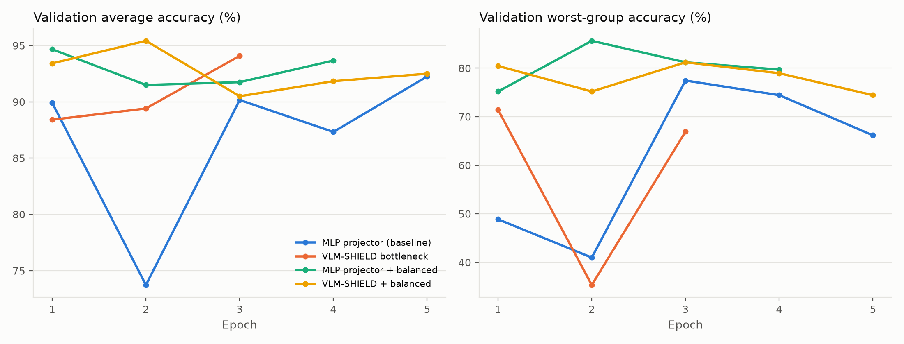
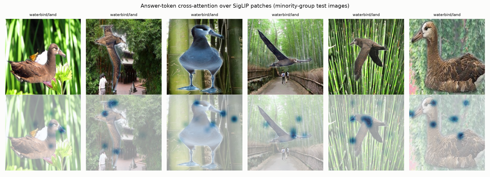
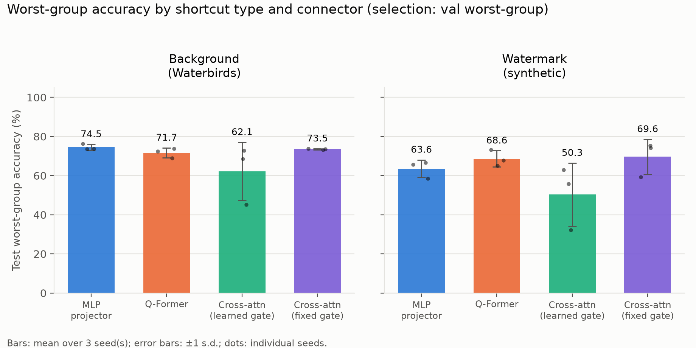
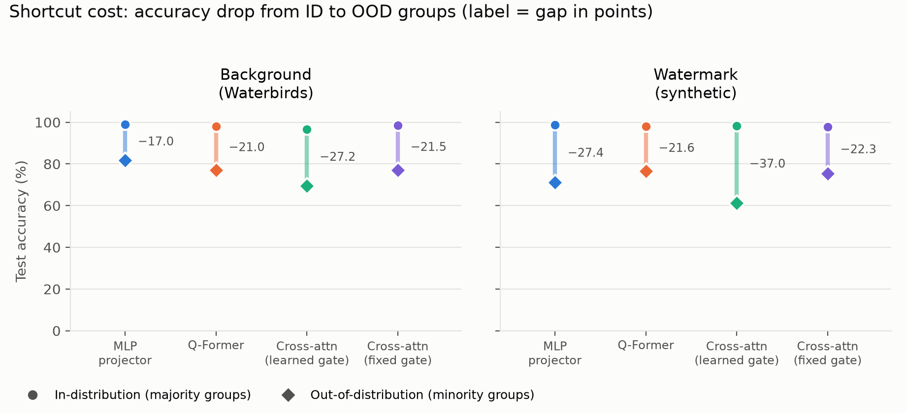
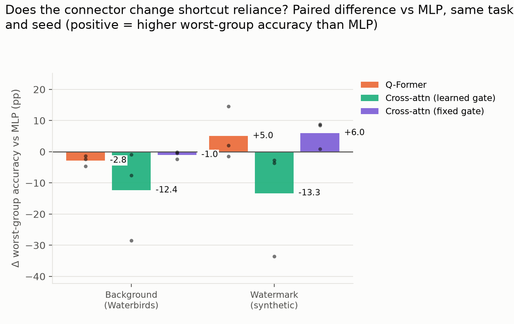

# VLM-SHIELD: Local Feature Bottlenecks against Shortcut Learning in VLMs

Vision-language models built as *vision encoder → MLP projector → LLM* can solve a task through a
spurious shortcut (backgrounds, watermarks, texture) instead of the object itself. **VLM-SHIELD**
replaces the projector with a **Local Feature Bottleneck**: the LLM's prompt tokens cross-attend to
individual SigLIP image patches, and the attended visual context enters the LLM through a
zero-initialised tanh gate. The answer token's attention map can be inspected directly.

This repository trains and evaluates the bottleneck against a standard MLP-projector baseline on
**Waterbirds** (Sagawa et al., 2020), the standard spurious-correlation benchmark: 95% of training
landbirds appear on land backgrounds and 95% of waterbirds on water, so the background predicts the
label during training. The test set breaks that correlation.

## Results (Waterbirds test set, n = 5,794)

| Model | Avg acc | Worst-group acc | Acc_ID | Acc_OOD | Δ_OOD | RSR |
| :--- | :---: | :---: | :---: | :---: | :---: | :---: |
| MLP projector (baseline) | 90.4% | 80.4% | 98.3% | 82.5% | 15.8 pp | 0.161 |
| VLM-SHIELD bottleneck | 89.2% | 77.3% | 97.1% | 81.3% | 15.8 pp | 0.163 |
| MLP projector + group-balanced sampling | **90.8%** | **82.8%** | 96.9% | **84.6%** | **12.3 pp** | **0.127** |
| VLM-SHIELD + group-balanced sampling | 89.4% | 80.9% | 96.5% | 82.3% | 14.2 pp | 0.147 |

Qwen3.5-4B (4-bit QLoRA) for every row; checkpoint selected by validation worst-group accuracy.
Per-group numbers are in [`metrics/research_paper_metrics.md`](metrics/research_paper_metrics.md),
and everything is in [`metrics/benchmark_results.json`](metrics/benchmark_results.json).





### What the numbers say

- **The shortcut is real.** Every model is 12–16 points less accurate on birds shown on the
  "wrong" background, and `waterbird/land` or `landbird/water` is always the worst group.
- **The cross-attention bottleneck does not beat the MLP projector here.** It is 2–3 points lower
  on worst-group accuracy in both the ERM and balanced settings. With one seed per configuration
  that gap is within noise, so the honest reading is "no measurable benefit", not "worse".
- **Group-balanced sampling helps both architectures** (+2.5 pp worst-group for the MLP, +3.6 pp
  for the bottleneck) and gives the best model overall: 82.8% worst-group, RSR 0.127.
- **Training is unstable under ERM.** Validation worst-group accuracy swings by 30–40 points
  between epochs (below), so early stopping on worst-group accuracy matters more than the number
  of epochs. Balanced sampling makes the curves much smoother.



### Where the bottleneck looks

The answer token's cross-attention over the 14×14 SigLIP patches, on test images of waterbirds
photographed on land backgrounds (the hardest group). Attention is sparse (normalised entropy
0.50 for the balanced model) and lands on both bird and background patches. The bottleneck makes
this inspectable, but it does not force the model onto the bird.



---

## Connector study: does the connector design change shortcut reliance?

A second experiment holds everything fixed (Qwen3.5-4B in 4-bit with LoRA, frozen SigLIP-base patch
features, same data, same training budget) and swaps only the vision-language connector:

- **MLP projector** (LLaVA-style), 2x2-pooled patches, 49 image tokens, 8.5M parameters
- **Q-Former** (BLIP-2-style), 32 learned queries, 11.4M parameters
- **Cross-attention bottleneck, learned gate** (this repo's design, no image tokens; Flamingo-style
  zero-initialised tanh gate), 8.9M parameters
- **Cross-attention bottleneck, fixed gate**: same, but the gate is fixed open and the output layer is
  zero-initialised instead, so it still starts as the identity but the optimiser cannot shut it

Each connector is first aligned on 10k COCO captions (300 steps, LLM frozen), then trained for 4 epochs
on two shortcut tasks: **Waterbirds** (background shortcut; official splits, test n = 5,794) and
**Watermark** (COCO images where a corner watermark predicts "is there a dog?" 95% of the time in
training; our own group-balanced val/test, test n = 2,400). 3 seeds per configuration, 24 runs in
total, on Kaggle 2x T4.

### Test worst-group accuracy (mean ± s.d. over 3 seeds, checkpoint chosen by validation WGA)

| Task | MLP projector | Q-Former | Cross-attn, learned gate | Cross-attn, fixed gate |
| :--- | :---: | :---: | :---: | :---: |
| Waterbirds | **74.5 ± 1.5** | 71.7 ± 2.5 | 62.1 ± 14.9 | 73.5 ± 0.3 |
| Watermark | 63.6 ± 4.4 | 68.6 ± 4.1 | 50.3 ± 16.1 | **69.6 ± 8.9** |

| Task | ID → OOD gap in points (MLP / Q-Former / learned gate / fixed gate) | Avg acc (same order) |
| :--- | :---: | :---: |
| Waterbirds | 17.0 / 21.0 / 27.2 / 21.5 | 90.4 / 87.6 / 83.0 / 87.7 |
| Watermark | 27.4 / 21.6 / 37.0 / 22.3 | 84.9 / 87.3 / 79.7 / 86.6 |

### Reference points on the same frozen SigLIP features (no LLM)

Logistic regression on mean-pooled features, 3 seeds ([`results_study/linear_baselines.md`](results_study/linear_baselines.md)):

| Method | Waterbirds WGA | Watermark WGA |
| :--- | :---: | :---: |
| Linear probe, ERM on the biased training set | 62.0 ± 0.0 | 46.5 ± 2.5 |
| DFR: probe retrained on a group-balanced half of validation | **84.2 ± 1.5** | **85.1 ± 1.3** |
| Probe on a group-balanced subsample of training | 84.3 ± 3.0 | 84.7 ± 1.4 |

What the numbers say:

- **The learned gate was the problem.** Fixing the gate open takes the cross-attention connector from
  62.1 ± 14.9 to 73.5 ± 0.3 WGA on Waterbirds and from 50.3 ± 16.1 to 69.6 ± 8.9 on Watermark, removes the
  collapsed seeds, and brings its ID-to-OOD gap in line with the other connectors. The learned gate stayed
  at 0.0005 after alignment, the gate-suppression effect reported by Farazi et al. (2026, arXiv
  2607.23335); with the gate shut the connector passes almost no visual signal and the model is left with
  the easiest cue.
- **Once the gate is fixed, connector design barely matters.** MLP, Q-Former and the fixed-gate connector
  are within a few points of each other on both tasks (Q-Former is 2.8 points below MLP on Waterbirds on
  all 3 seeds; the Watermark differences are inside the seed spread).
- **The VLMs beat a linear probe on the same features but stay far below DFR.** Every working connector is
  12-23 points above the ERM probe, yet 10-20 points below DFR, which only retrains a linear layer on a
  few balanced examples. The information needed is in the features; the VLM does not use it.
- **Attention on the shortcut does not by itself mean reliance on it.** Both cross-attention variants put
  far more attention on the watermark corner when the watermark is present (learned gate 16.7% vs 6.1%,
  fixed gate 18.2% vs 7.0%; uniform 8.2%), yet only the learned-gate variant fails. Q-Former shifts less
  (11.6% vs 7.7%). See [`results_study/attention_watermark.csv`](results_study/attention_watermark.csv).
- **The held-out question phrasing** gives the same WGA as the training phrasings to within 1-2 points.

Full tables, including checkpoint selection without group labels: [`results_study/summary.md`](results_study/summary.md);
every run: [`results_study/all_runs.csv`](results_study/all_runs.csv).







Run it: [`study/kaggle_kernels/`](study/kaggle_kernels/) holds the Kaggle scripts (data prep on one
session, training on the next; a follow-up session resumes from saved results). Speed on a T4,
batch 16: 4.0 / 2.5 / 1.7 s per step for MLP / Q-Former / bottleneck after pooling MLP tokens
196 → 49 and dropping gradient checkpointing (MLP was 13.7 s before); `study/bench_speed.py`
measures this.

## Related work and where this study stands

Literature check (October 2026): Google Scholar, OpenAlex (covers Springer, Elsevier, IEEE, ACM, ACL,
AAAI and arXiv), forward citations of the closest papers, and full reads of the five nearest. No
paper we found compares connector designs for shortcut reliance in LLM-based VLMs. Numbers below are
as reported by each paper, on their own setups, so they are context rather than a like-for-like ranking.

### Shortcuts in vision-language models

| Work | What they did | Models | Data | Reported result |
| :--- | :--- | :--- | :--- | :--- |
| Bleeker et al., 2024 (arXiv 2402.17510) | Inject synthetic per-pair shortcuts (MNIST digit in image + number in caption) into contrastive training; mitigate with latent target decoding (LTD) or implicit feature modification (IFM) | CLIP (fine-tuned), VSE++ | Flickr30k, MS-COCO retrieval | Flickr30k recall sum: VSE++ 409.0 without shortcuts, 3.4 with them, 274.6 with LTD; CLIP 543.5 without, 436 with, 464 with LTD, 495 with IFM |
| SpurLens (arXiv 2503.08884) | Automatic detection of spurious cues in multimodal LLMs | LLaVA and other MLLMs, zero-shot | Waterbirds and others | LLaVA per-group accuracy: waterbird on land 13.2%, waterbird on water 59.3%, landbird groups 77.4% and 99.8% |
| SpuriVerse (arXiv 2506.18322) | Benchmark of 124 spurious correlations mined from real VQA data | Large VLMs | SpuriVerse | Fine-tuning on spurious cases trades off accuracy on ordinary samples |
| PURGE (arXiv 2608.29996) | Unlearning to remove object-background correlations | LLaVA-1.6-7B, Qwen3-VL-8B, Qwen3.5-9B | Object-background benchmarks | Connector treated as fixed |
| MD3 / MAD (ICLR 2026 submission, OpenReview NTbAH4UD6K) | GPT-4o "critic agents" rewrite biased answers into ~50k debiased reasoning chains, then fine-tune MLLMs | LLaVA-v1.5-7B, LLaVA-Llama-3-8B, Llama-3.2-11B-Vision | VQA-CP, VQA-CE, GQA-OOD; Waterbirds on ResNet-50 | VQA-CP (LLaVA-v1.5-7B): 63.98 → 68.83. Waterbirds WGA (ResNet-50): ERM 63.7, GroupDRO 89.9, DFR 90.2, MOO 91.8, MAD 93.6 |
| Scaling VLMs Is Not Enough (arXiv 2607.28211) | 194 contrastive models, 16 families; which design factors predict robustness | OpenCLIP models | ImageNet, CelebA, UrbanCars | Data size and curation matter more than scale; connector type not studied |

### Connector design

| Work | What they did | Reported result | Shortcuts measured? |
| :--- | :--- | :--- | :--- |
| Modality Integration Rate (arXiv 2410.07167) | Alignment quality of LLaVA-1.5 with an MLP vs a Q-Former connector | MLP clearly outperforms Q-Former after instruction tuning | No |
| Rethinking Projector Training (arXiv 2610.18598) | What projector alignment learns; training-free PORTAL projector | Alignment is coarse; 10-20% of the 558k pairs recover most gains; PORTAL matches a trained MLP with ~135x fewer alignment FLOPs | No |
| The Gate Always Closes (Farazi et al., arXiv 2607.23335) | Learnable gates for injecting signals into frozen VLMs, across five designs | Every gated pathway ends up behaviourally closed; recommends fixed injection | No |
| Honeybee, TokenPacker (IJCV 2025), Cambrian-1 | Locality-aware and efficient projectors | Benchmark accuracy and token efficiency | No |

### Group-robustness baselines (Waterbirds worst-group accuracy, ResNet-50)

| Method | Uses group labels in training | WGA | Source |
| :--- | :--- | :---: | :--- |
| ERM | No | 63.7 | as reported in MD3 |
| JTT | Only for model selection | 86.7 | Liu et al., 2021 |
| GroupDRO | Yes | 89.9 | as reported in MD3 |
| DFR | Small group-balanced set | 90.2 | as reported in MD3 |
| **This repo, MLP projector (Qwen3.5-4B, connector study)** | Only for model selection | **74.5 ± 1.5** | 3 seeds |
| **This repo, MLP + group-balanced sampling (PR #1 run)** | Yes | **82.8** | 1 seed |
| **This repo, DFR on frozen SigLIP-base features** | Small group-balanced set | **84.2 ± 1.5** | 3 seeds |

### Where this study stands out

- **Question nobody isolated:** with the LLM, vision features, data and budget held fixed, does the
  connector (MLP, Q-Former, cross-attention) change how much a generative VLM relies on a shortcut?
  Prior shortcut work studies contrastive models (Bleeker; scaling study) or whole MLLMs (SpurLens,
  SpuriVerse, PURGE, MD3); prior connector work measures benchmark accuracy, not robustness.
- **Group-level evaluation of generative VLMs:** worst-group accuracy, ID-to-OOD gap, a held-out question
  phrasing, and two checkpoint-selection rules, over seeds.
- **A mechanism with a fix:** a learnable injection gate stays shut (0.0005), and that alone turns a
  cross-attention connector from on-par to the most shortcut-reliant and unstable; fixing the gate open
  restores it (+11.4 and +19.3 WGA points). This links the gate-suppression effect of Farazi et al. to
  shortcut reliance, which they did not measure.
- **Reference points on the same features:** a linear ERM probe and DFR bracket every VLM, showing how
  much of the gap is the model's, not the features'.
- **Once that pitfall is avoided, connector type is a near-null factor**, consistent with MD3's and the
  scaling study's view that data and training, not architecture, are the main lever.

## Setup

| Component | Choice |
| :--- | :--- |
| Vision encoder | `google/siglip-base-patch16-224`, frozen; 196 patch features (768-d) cached once |
| Language model | `Qwen/Qwen3.5-4B` text decoder, 4-bit NF4 (QLoRA), LoRA r=16 on all attention/MLP projections |
| VLM-SHIELD connector | `LocalFeatureBottleneck`: prompt tokens attend over the 196 patches; output added to the token embeddings through `tanh(gate)`, gate initialised at 0 |
| Baseline connector | LLaVA-style 2-layer MLP over 2×2-pooled patches → 49 prefix tokens |
| Task | Prompt *"Is the bird in this image a landbird or a waterbird?"*; prediction = LLM next-token logits restricted to the two answer tokens |
| Loss | Cross-entropy + 0.1 × normalised attention-entropy penalty `1 − H(A)/log 196` (bottleneck only) |
| Training | Paged 8-bit AdamW, cosine schedule, batch 16, gradient checkpointing, bf16; up to 8 epochs with early stopping on validation worst-group accuracy |
| Variants | ERM (natural sampling) and group-balanced sampling (each bird/background group equally likely) |
| Hardware | One RTX 3050 Laptop GPU (4 GB) |

The 248k-row token embedding matrix (tied with the LM head) is never put on the GPU: the prompt is
fixed, so its embeddings are computed once, and only the two answer-token rows of the LM head are
kept. This, plus 4-bit weights, is what lets a 4B model train in 4 GB.

### Metrics

Groups are (bird, background): `landbird/land`, `landbird/water`, `waterbird/land`, `waterbird/water`.

- **Average accuracy** over the test set.
- **Worst-group accuracy**: the lowest of the four group accuracies (the standard Waterbirds metric).
- **Acc_ID / Acc_OOD**: accuracy on majority groups (bird on its usual background) vs minority groups.
- **Δ_OOD = Acc_ID − Acc_OOD** and **RSR = Δ_OOD / Acc_ID** (relative shortcut reliance).

All numbers are computed by `evaluate.py` from model predictions on the held-out test split.

---

## Reproduce

```bash
python -m venv .venv && source .venv/bin/activate
pip install torch --index-url https://download.pytorch.org/whl/cu124
pip install -r requirements.txt

python scripts/prepare_waterbirds.py          # Waterbirds -> data/waterbirds/{images,metadata.csv}
python scripts/download_models.py             # SigLIP + Qwen3.5-4B into the HF cache
python scripts/cache_siglip_features.py       # frozen SigLIP features -> data/siglip_patch_features.npy

# One run
python train.py --mode bottleneck --balanced --gradient_checkpointing

# All four runs (MLP / bottleneck x ERM / balanced), 110 min budget each, then evaluation
PYTORCH_CUDA_ALLOC_CONF=expandable_segments:True scripts/run_all.sh Qwen/Qwen3.5-4B 110

python evaluate.py                            # metrics/*.csv|json|md + figures
python -m pytest tests                        # unit tests
python app.py --run bottleneck_balanced       # Gradio demo with attention heatmap
```

## Repository layout

```
src/data/waterbirds.py          dataset, cached-feature loader, group metrics
src/models/debiased_vlm.py      LocalFeatureBottleneck, MLPPrefixProjector, DebiasedVLM (QLoRA Qwen3.5)
src/models/*_scratch.py         small pure-PyTorch SigLIP/Qwen re-implementations (tests / teaching)
src/models/lora.py              minimal LoRA layer used by the scratch models
src/training/loss.py            task loss + attention entropy / shortcut-suppression regularisers
src/training/engine.py          train / eval loops, group-balanced sampler
scripts/                        data preparation, feature caching, model download, run_all.sh
train.py / evaluate.py / app.py training, evaluation + figures, demo
metrics/                        exported results and figures
src/study/, study/              connector study: connectors, generic VLM wrapper, tasks, training, plots
results_study/, docs/figures/study/   connector-study results and figures
```

## Limitations

- Waterbirds study at the top: one seed per configuration; differences of a few points are within run-to-run noise.
- Connector study:
  - 3 seeds and 2 tasks, one LLM (Qwen3.5-4B, 4-bit) and one small vision encoder (SigLIP-base), so
    differences under ~5 points are not significant.
  - Seeds vary only the task stage; stage-1 alignment ran once per connector (`--align_per_seed` now exists).
  - LoRA also adapts the LLM, which can learn the shortcut whatever the connector; a frozen-LLM run
    (`--freeze_llm`) separates the two.
  - Alignment is short (300 steps on 10k captions; LLaVA uses 558k pairs), and the MLP uses 2x2-pooled
    patches (49 tokens) instead of all 196 for speed.
  - Average accuracy is the plain test mean, not reweighted by training group sizes as in some papers.
  - Checkpoints are selected with group labels (val WGA); the label-free rule is in the summary tables.
- Waterbirds has no shortcut-region masks in this setup, so the shortcut-suppression term of the
  loss is implemented and tested but not used in these runs.
- The vision encoder is frozen; only LoRA adapters and the connector are trained.
